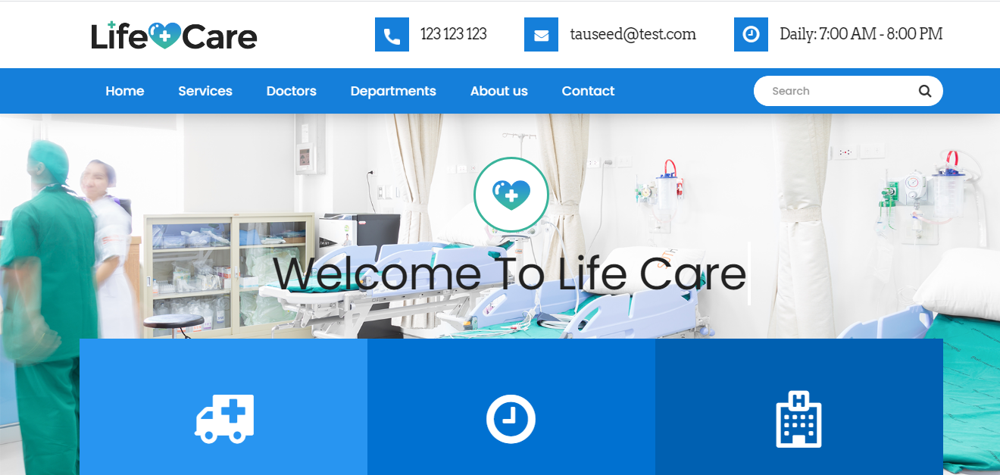
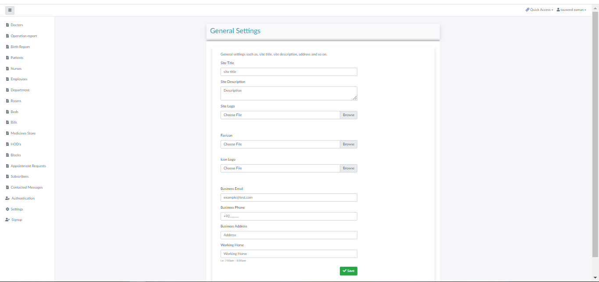
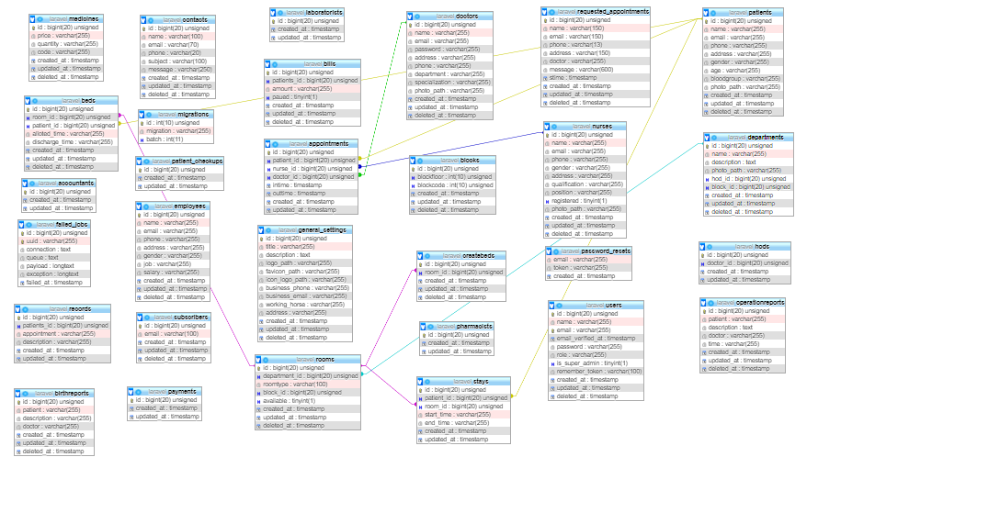

# Hospital Management System

A full-stack web application built with **Laravel** and **Livewire** for managing hospital data: a public website plus an admin dashboard.


## Screenshots

### Front end


### Admin dashboard


### Database tables


## Features

**Public website**
- Home, about, doctors and contact pages
- Online appointment requests
- Newsletter subscription and contact form

**Admin dashboard** (Super Admin access, built with Livewire)
- Dashboard overview and site settings
- Patients, patient check-ups and patient bills / payments
- Doctors, nurses, other employees and departments (with heads of department)
- Appointments and requested appointments
- Rooms, beds, blocks and patient stays
- Medicines store
- Operation reports and birth reports
- Subscribers and contact messages
- Roles and permissions

## Tech stack

- Laravel 8 (PHP 7.3 / 8.x)
- Livewire 2 for the admin dashboard
- Intervention Image for image handling
- MySQL
- Blade templates, Laravel Mix

## Getting started

### Requirements

- PHP and [Composer](https://getcomposer.org/)
- MySQL
- [Git](https://git-scm.com/)

### Installation

```bash
git clone https://github.com/MohammedAbd20/hospitalMS.git
cd hospitalMS

composer install
cp .env.example .env
php artisan key:generate
```

Set your database credentials in `.env`, then:

```bash
php artisan storage:link
php artisan migrate:fresh --seed
php artisan serve
```

Open `http://127.0.0.1:8000`.

## Running the tests

```bash
php artisan test
```

The feature tests run on in-memory SQLite and cover the public pages, dashboard access control (guest / no role / admin / accountant) and that every admin page renders. They also run on every push through GitHub Actions.

## Demo admin account

Created by the database seeder, **for local testing only**:

| Email | Password |
|---|---|
| `admin@example.com` | `password` |
| `accountant@example.com` | `password` |

Dashboard access is limited to users that have a role (admin / accountant). Accounts created through the public registration form have no role and receive a 403 on `/admin/*`.

Change or remove these credentials before deploying anywhere public.

## Author

**Mohammed Hamdi Abdelrahman**: [GitHub](https://github.com/MohammedAbd20) · [LinkedIn](https://www.linkedin.com/in/mohammed-abdelrahman-web/)
